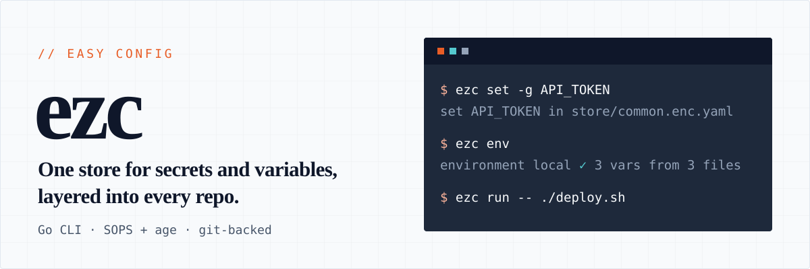
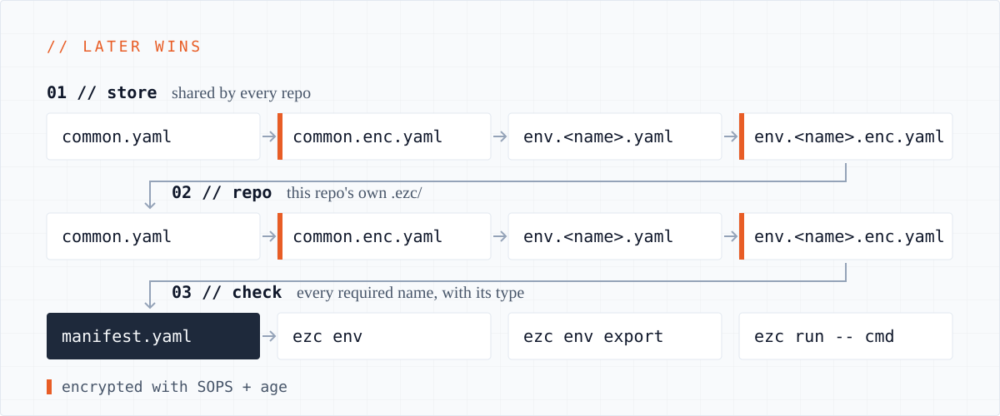

<p align="center">
  
</p>

`ezc` ("easy config") is a Go CLI that gives a person or a small team one place for secrets and variables. A global store, which is a git repo, holds values common to every environment and values per environment; a repo keeps the same kind of values in its own `.ezc/`, layered over the store. A manifest says which values a repo requires, and `ezc` validates the composed environment against it, then exports it or runs a command with it. Secrets are encrypted with [SOPS](https://github.com/getsops/sops) and [age](https://github.com/FiloSottile/age), and `ezc` manages who can read them.

## Install

```sh
go install github.com/thinkjones/easy-config/cli/cmd/ezc@latest
```

`ezc` needs `git` 2.23 or later, and [`sops`](https://github.com/getsops/sops) for secrets. `ezc setup` checks for both.

## Quick start

```sh
# once per machine: your key, the store and ezc's config
ezc setup --new-local

# put values in the store, for every repo
ezc set -g REGION us-east-1 --type str --desc "where we run"
ezc set -g API_TOKEN --type secret --desc "the API's token"   # asks for the value at a hidden prompt

# use them in a repo
cd my-repo
ezc repo init                      # creates .ezc/ in this folder
ezc set PORT 8080 --type int --desc "the port to listen on"   # a value of the repo's own
ezc env                            # check the environment against the manifest
ezc run -- <command>               # run a command with it
```

`ezc env` answers in one line and never prints a value:

```
environment local ✓ 3 vars from 3 files
```

When something does not work, run `ezc doctor`: it checks the machine, the store and the repo, and says what to do about each thing it finds.

## How it works

<p align="center">
  
</p>

- **One layout, two places.** The store and a repo's `.ezc/` hold the same files: `common.yaml` for every environment, `env.<name>.yaml` for one, and an `.enc.yaml` beside each for secrets. The store's files load first, then the repo's, and a later file wins.
- **The manifest is the contract.** `manifest.yaml` declares every name with its type and description, required or optional. There are no defaults: a missing required value, or one of the wrong shape, fails `ezc env`, which says what is wrong and never prints the value.
- **Secrets stay encrypted at rest.** A value declared `secret` goes to the encrypted file, typed at a hidden prompt or piped on stdin, never given as an argument.
- **The store is a git repo.** Every write to it is one commit that names the files it changed and never a value. Commands tell you on one `store:` line when it is ahead of or behind its remote.

The environment is named by the argument, else `EZC_ENV`, else `APP_ENV`; with none of them, `local` applies when it exists. The details are in the [reference](docs/reference.md#resolution).

## How a repo loads its environment

There are three ways in:

- mise: in `mise.toml`, `[env]` then `_.source = ".ezc/env.sh"`. `ezc repo init` writes `.ezc/env.sh`.
- direnv: `source_env .ezc/env.sh` in `.envrc`.
- neither: `ezc run -- <command>` runs one command with the variables and leaves the shell alone.

The shim never fails the shell, so a broken config does not make `cd` unusable. `ezc env` is the check that fails; make tasks depend on it.

## Sharing a store

```sh
ezc setup --new-github owner/repo  # publish the store you have as a private GitHub repo (needs gh)
ezc store push                     # after you change the store
ezc store pull                     # to bring in changes made elsewhere
```

A second person, or a second machine with a key of its own, asks for access and is let in by someone who already has it:

```sh
ezc join owner/repo                # on the new machine: clone the store and file a request with your public key
ezc user approve sam               # on a machine with access: shows the whole key, asks, then lets sam in
ezc user remove sam                # sam can no longer read it; lists the secrets that now need new values
ezc repo add                       # inside owner/app: register it, so its own secrets follow the store's recipients
ezc bot add ci --repo owner/app    # a key for CI, saved as an Actions secret of owner/app
```

Who can read the store is written in one file, `recipients.yaml`, and every encrypted file is encrypted for exactly the keys it names. Removing a key re-encrypts each file from scratch and records every secret that key could read as due for a new value, because only a new value protects a secret that was once readable. That file is on the store's default branch, so protect the branch on GitHub: let only the people who can read the store push to it. A registered repo checked out on the machine that makes the change is re-wrapped too. See [Access](docs/access.md), [Repos](docs/repos.md) and [Bots and CI](docs/ci.md).

## Commands

| Command | What it does |
| --- | --- |
| `ezc setup` | Take a machine from nothing to a working store: check the tools, create your key, create or clone the store, write the config. `--ci` sets a CI job up to read a store. |
| `ezc join` | Ask for access to an existing store from this machine. |
| `ezc repo init` | Create `.ezc/` in the working directory with a manifest, `env.local.yaml` and the `env.sh` shim. |
| `ezc repo add`, `remove`, `list`, `check`, `uses`, `rewrap` | Register the repos that use the store; check them all, find who uses a name, and keep their own secrets encrypted for the store's recipients. |
| `ezc env` | Check an environment against the manifest. `ezc env export` prints it, for `eval` or as JSON. |
| `ezc run` | Run a command with the environment added to its own. |
| `ezc list`, `ezc get` | List the names an environment holds and where each comes from; print one value (a secret needs `--reveal`). |
| `ezc set`, `ezc unset`, `ezc edit` | Write, remove or hand-edit values, in the repo or with `-g` in the store. |
| `ezc store status`, `pull`, `push` | See how the store stands against its remote and keep it level. |
| `ezc store audit`, `ezc store rewrap` | Check the store's files against its manifest; make its encrypted files match `recipients.yaml` again. |
| `ezc user list`, `add`, `requests`, `approve`, `deny`, `remove`, `rotate` | See and change who can read the store. |
| `ezc bot add`, `remove`, `rotate` | Give CI a key of its own, take it away or replace it. |
| `ezc doctor` | Report the health of the machine, the store and the repo, with the fix for each finding. |
| `ezc manifest validate`, `ezc manifest schema` | Check that the manifest is well formed; print its JSON Schema. |
| `ezc codegen python` | Generate a pydantic config module from the manifest. |

Every flag and every exit status is in the [command reference](docs/reference.md#commands); `ezc help <command>` gives a command's flags on the command line.

## Documentation

| Page | What is in it |
| --- | --- |
| [Set up](docs/setup.md) | What `ezc setup` makes, what it never overwrites, and how it adopts a store made by hand. |
| [The store](docs/store.md) | Writes as commits, the refusals that protect them, and `ezc store status`, `pull` and `push`. |
| [Access](docs/access.md) | `recipients.yaml`, joining, approving a request, removing someone, rotating a key. |
| [Repos](docs/repos.md) | `repos.yaml`, where each repo is checked out, checking every repo, and how a repo's own secrets follow the store's recipients. |
| [Bots and CI](docs/ci.md) | A key for a bot, the two secrets a job needs, and a GitHub Actions workflow. |
| [Reference](docs/reference.md) | Every command, the files, encryption and the resolution rules. |
| [When something is wrong](docs/troubleshooting.md) | What `ezc doctor` reports and what to do about it. |

## Status and known limits

This is `ezc` 0.5. The TUI comes later.

- **A repo is re-wrapped only where it is checked out.** A change to who can read the store re-wraps the registered repos checked out on the machine that makes it; run `ezc repo rewrap --all` on a machine that has the others (see [Repos](docs/repos.md#after-a-change-to-who-can-read-the-store)). A repo's secrets that a key leaving it could read are listed, not recorded in `rotation-due.yaml`.
- **`ezc setup --ci` works with github.com only.** The token is offered to `https://github.com` and no other host, so a store on a GitHub Enterprise host or anywhere else cannot be cloned by `--ci`.
- **A repo gets one bot.** Every bot's key is saved as the `EZC_AGE_KEY` Actions secret, so a repo holds one. `ezc bot add` refuses a `--repo` that another bot's entry in `recipients.yaml` already names. It cannot see a key that was put in a repo some other way (`--print-private`, or `gh secret set` by hand), and would replace it.
- **Two machines that declare a new name at the same time** must resolve the conflict with git (see [Syncing the store](docs/store.md#syncing-the-store)).

## Development

```sh
mise run cli:build       # build ezc into cli/bin/
mise run cli:test        # the gate: gofmt, vet, tests
mise run cli:test:sops   # the same, with the real-sops and real-git tests required
```

[`AGENTS.md`](AGENTS.md) says where things are and [`CLAUDE.md`](CLAUDE.md) lists the sharp edges.

## License

[MIT](LICENSE)
